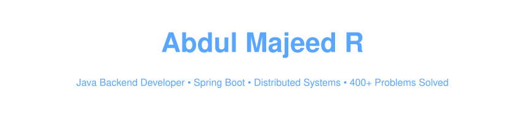

<div align="center">

<!-- HERO BANNER (HOSTED LOCALLY) -->


<!-- TYPING HEADER -->
<a href="https://github.com/Abu1820">
  
</a>

<br/>

<!-- SOCIAL / CONTACT QUICK BADGES -->
<p align="center">
  <a href="mailto:abdulmajeed564600@gmail.com"></a>
  <a href="https://www.linkedin.com/in/abdulmajeedr/"></a>
  <a href="https://leetcode.com/u/Abu18/"></a>
  <a href="https://abdulmajeedr-portfolio.vercel.app"></a>
  <a href="https://github.com/Abu1820"></a>
</p>

<!-- GLOWING DIVIDER -->


</div>

## 👨‍💻 About Me

<table>
  <tr>
    <td valign="top" width="58%">
      <p>
        👋 Hi there! I'm <b>Abdul Majeed R</b>, a passionate <b>Java Backend Developer</b> and <b>Computer Science & Engineering</b> undergraduate at <i>KPR Institute of Engineering and Technology</i> (CGPA: <b>9.03 / 10.0</b>).
      </p>
      <p>
        I specialize in engineering scalable, secure RESTful web services and enterprise backend systems using <b>Java, Spring Boot, Spring Data JPA, Hibernate, MySQL, and JWT Authentication</b>.
      </p>
      <ul>
        <li>💼 <b>Work Experience:</b> Java Backend Intern at <b>Infosys Springboard</b> & Full Stack Intern at <b>MainCrafts</b>.</li>
        <li>🧠 <b>Problem Solving:</b> Solved <b>400+ problems on LeetCode</b> with consistent problem-solving practice and contest participation.</li>
        <li>📚 <b>Published Author:</b> Co-author of <i>"Mastering Recommendation Systems: From Basics to Breakthroughs"</i> on <b>Amazon Kindle</b>.</li>
        <li>🚀 <b>Flagship Impact:</b> Creator of <b>CivicPulse</b> & <b>UNIORA</b> (awarded institutional <b>Seed Funding from KPRIET</b>).</li>
        <li>🎯 <b>Current Focus:</b> Deepening expertise in Microservices architecture, Distributed Caching (Redis), and Cloud Native platforms.</li>
      </ul>
    </td>
    <td valign="middle" align="center" width="42%">
      
    </td>
  </tr>
</table>

<div align="center">
  
</div>

## 🛠️ Tech Stack & Competencies

<table>
  <tr>
    <td align="left" width="22%"><b>Languages</b></td>
    <td>
      
      
      
      
      
    </td>
  </tr>
  <tr>
    <td align="left"><b>Frameworks & Backend</b></td>
    <td>
      
      
      
      
      
      
    </td>
  </tr>
  <tr>
    <td align="left"><b>Databases & Cloud</b></td>
    <td>
      
      
      
      
    </td>
  </tr>
  <tr>
    <td align="left"><b>Developer Tools</b></td>
    <td>
      
      
      
      
      
    </td>
  </tr>
  <tr>
    <td align="left"><b>Core Fundamentals</b></td>
    <td>
      
      
      
      
      
    </td>
  </tr>
</table>

<div align="center">
  
</div>

## 💼 Professional Experience

<details open>
  <summary><b>Infosys Springboard — Java Backend Development Intern</b> &nbsp;|&nbsp; <i>June 2026 – August 2026</i> &nbsp;|&nbsp; 📍 Virtual Internship 7.0</summary>
  <br/>

> `Java` • `Spring Boot` • `Spring Data JPA` • `Hibernate` • `JWT Security` • `MySQL` • `REST APIs` • `Postman`

- **Engineered High-Throughput RESTful APIs**: Developed modular backend endpoints in **Java & Spring Boot** managing user identity, automated grievance logging, and resolution tracking pipelines for the Smart Governance Platform.
- **Implemented Stateless Auth & RBAC**: Integrated **Spring Security with JSON Web Tokens (JWT)**, securing API access across multiple user roles (Citizens, Municipal Officers, Admins) and eliminating session vulnerabilities.
- **Data Persistence Optimization**: Architected normalized schemas with **Spring Data JPA & Hibernate** on **MySQL**, executing complex indexed queries and reducing payload fetch overhead.
- **Professional Recognition**: Conferred official **Infosys Java Foundation** and **Python Foundation** verified professional credentials during the internship.
</details>

<br/>

<details>
  <summary><b>MainCrafts Technology — Full Stack Web Development Intern</b> &nbsp;|&nbsp; <i>June 2026 – July 2026</i> &nbsp;|&nbsp; 📍 Virtual (Intern ID: MT6576)</summary>
  <br/>

> `HTML5` • `CSS3` • `JavaScript (ES6+)` • `LocalStorage` • `Responsive Design` • `Git`

- **Responsive Multi-Page Interfaces**: Built cross-device responsive UI architectures with **HTML5 semantic elements, CSS3 Flexbox/Grid**, and pure **JavaScript**.
- **Client-Side State Persistence**: Developed interactive modular contact and feedback components utilizing **LocalStorage** for client-side state caching and live form validation.
- **Quality Assurance**: Awarded an official **Internship Completion Certificate** and **Letter of Recommendation (LOR)** for exemplary project delivery and code standards.
</details>

<div align="center">
  
</div>

## 🚀 Featured Projects

<div align="center">

| Project | Tech Stack | Highlights & Impact Metrics |
| :--- | :--- | :--- |
| **[CivicPulse](https://github.com/Abu1820/CivicPulse-Smart-Governance-Platform)**<br/><sub>Smart Governance Platform</sub> | `Java` `Spring Boot` `MySQL`<br/>`Hibernate` `JWT` `React` | • Developed end-to-end municipal issue tracking system with automated departmental routing.<br/>• Configured stateless JWT token auth protecting 15+ REST endpoints with multi-role access control.<br/>• Optimized Spring Data JPA ORM relationships, ensuring sub-100ms database response times. |
| **[UNIORA](https://github.com/Abu1820/UNIORA)**<br/><sub>Welfare Schemes Platform</sub> | `Python` `JavaScript` `Supabase`<br/>`Cloudflare Workers` `HTML/CSS` | • Built an intelligent rule-based eligibility engine mapping citizens to government benefits.<br/>• **Awarded institutional Seed Funding from KPRIET** for technical innovation and social impact.<br/>• Deployed on Cloudflare Workers edge network, achieving global sub-50ms latency with offline accessibility. |
| **[Portfolio](https://github.com/Abu1820/Portfolio)**<br/><sub>3D Interactive Portfolio</sub> | `React` `Three.js` `TypeScript`<br/>`Tailwind CSS` `Vite` | • Designed modern interactive portfolio with 3D canvas rendering and fluid responsive animations.<br/>• Integrated automated project showcases, verified credentials viewer, and interactive contact systems.<br/>• Scored 95+ performance benchmarks on mobile and desktop web audits. |

</div>

<div align="center">
  
</div>

## 📈 GitHub Contribution Activity

<div align="center">
  <p><b>186+ Contributions in the Last Year</b></p>
  <a href="https://github.com/Abu1820">
    
  </a>
</div>

<div align="center">
  
</div>

## 🏆 Honors & Key Achievements

<div align="center">

| 🏅 | Achievement | Details & Key Metrics |
| :---: | :--- | :--- |
| 🥇 | **1st Prize — CIT CRYPTERA 2026** | Won **1st place and ₹1,500 cash award** in Technical Puzzle Clash covering Operating Systems, DBMS, and Networks at Coimbatore Institute of Technology (Jan 2026). |
| 🥈 | **2nd Prize — IEEE CodeQuest** | Secured **2nd place** in competitive coding tournament (Logic Sprint, HackerRank Arena, Mystery Code) organized by IEEE Education Society, KPRIET (Aug 2026). |
| 💡 | **KPRIET Seed Funding Grant** | Selected for and received institutional **Seed Funding from KPRIET Innovation Cell** for [**Project UNIORA**](https://github.com/Abu1820/UNIORA) ([Live Platform](https://uni-ora.uniora-official.workers.dev/dashboard/)) based on community feasibility and impact. |
| 💻 | **LeetCode 400+ Problem Solver** | Solved **400+ problems on LeetCode** with active participation in weekly and biweekly contests ([Profile](https://leetcode.com/u/Abu18/)). |
| 📚 | **Published Book Co-Author** | Co-authored ***"Mastering Recommendation Systems: From Basics to Breakthroughs"*** published on [Amazon Kindle](https://amzn.in/d/j7muHtb), covering CF and deep learning architectures. |
| 🎖️ | **NPTEL Elite + Silver (80%)** | Ranked in Elite tier among **19,100+ candidates** in *Industry 4.0 and Industrial Internet of Things* certified by IIT Kharagpur (Prof. Sudip Misra). |

</div>

<div align="center">
  
</div>

## 🎓 Education & Certifications

<div align="center">

| Degree / Certification | Institution | Year | Grade / Score |
| :--- | :--- | :---: | :---: |
| **B.E. Computer Science and Engineering** | KPR Institute of Engineering and Technology, Coimbatore | 2024 – 2028 | **CGPA: 9.03 / 10.0** |
| **Higher Secondary Examination (HSC)** | St. Thomas Higher Secondary School, Pattukkottai | March 2024 | **94.0%** |
| **Certified Blockchain Associate (CBA)** | Kerala Blockchain Academy & MLG Blockchain | 2026 | **Certified Associate** |
| **Infosys Springboard Certifications** | Infosys Limited | 2026 | **Java Foundation & Python Foundation** |

</div>

<div align="center">
  
</div>

## 📚 Currently Exploring & Upskilling

```text
  🧱 Distributed Systems       → Microservices Communication, Service Discovery (Eureka/Spring Cloud)
  ⚡ Performance Caching        → Redis Caching Strategies, Message Queuing (RabbitMQ / Kafka)
  🐳 Containerization & CI/CD  → Dockerizing Spring Boot Microservices & GitHub Actions Pipelines
  🧠 Competitive Programming    → Advanced Problem Solving & Algorithm Optimization
```

<br/>

<!-- FOOTER WAVE (HOSTED LOCALLY) -->
<div align="center">
  
</div>